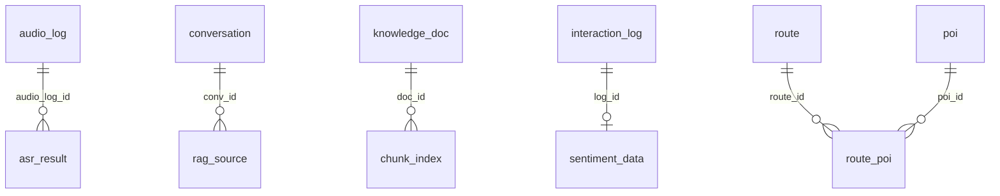

# 数据库设计说明书

**项目名称**：景区导览 AI 数字人系统
**小组**：第八组
**编写人**：成员D（数据洞察与运营大屏 / 数据库统一负责人）
**编写日期**：2026-10-20
**版本**：v1.1（2026-10-22 更新：对照需求规格说明书由 8 张表补齐至 14 张表，覆盖需求 3.2.2 / 3.2.3 / 3.2.4 子系统与 5.4 数据字典）

---

## 目 录

1. 引言
   1.1 编写目的
   1.2 术语表
2. 数据库环境说明
3. 数据库的命名规则
4. 逻辑设计
5. 物理设计
   5.1 表汇总
   5.2 表设计
6. 脚本文件
- 附录A 存储引擎与字符集选型说明
- 附录B 读写分离与主从复制设计
- 附录C 核心查询执行计划（EXPLAIN）分析

---

## 1 引言

### 1.1 编写目的

本文档描述景区导览 AI 数字人系统的数据库设计，作为全组数据库对象的唯一定义来源，供开发、联调、测试、评审与答辩使用。文档覆盖以下内容：

- 数据库运行环境与选型（第 2 章）；
- 数据库对象的统一命名规则（第 3 章）；
- 逻辑设计，即实体关系（ER）模型（第 4 章）；
- 物理设计，即全部数据表的结构明细（第 5 章）；
- 建表脚本的位置与执行方式（第 6 章）。

本文档与建表脚本 [backend/sql/01_schema.sql](../backend/sql/01_schema.sql)、ER 图 [docs/db-er-diagram.mermaid](./db-er-diagram.mermaid) 三者需保持同步：**脚本改动后，第 5 章与 ER 图必须同步更新。**

### 1.2 术语表

| 序号 | 术语或缩略语 | 说明性定义 |
| --- | --- | --- |
| 1 | DB | Database，数据库 |
| 2 | RDBMS | Relational Database Management System，关系型数据库管理系统 |
| 3 | DDL | Data Definition Language，数据定义语言，如 CREATE TABLE |
| 4 | DML | Data Manipulation Language，数据操纵语言，如 INSERT / SELECT |
| 5 | ER 图 | Entity-Relationship Diagram，实体关系图，描述表与表之间的关联 |
| 6 | InnoDB | MySQL 默认存储引擎，支持事务、行级锁与外键 |
| 7 | 主键 (PK) | Primary Key，唯一标识表中每一行的列 |
| 8 | 外键 (FK) | Foreign Key，引用另一张表主键的列，用于保证引用完整性 |
| 9 | 索引 | 加速数据检索的数据结构，本系统统一使用 B+ 树索引 |
| 10 | 主从复制 | Replication，主库把 binlog 同步给从库，从库重放后数据一致 |
| 11 | binlog | 二进制日志，记录主库上的数据变更，是主从复制的基础 |
| 12 | 读写分离 | 写操作走主库、读操作走从库，以分摊数据库压力 |
| 13 | 复制延迟 | 从库数据落后于主库的时间差，读写分离场景下需重点评估 |
| 14 | 事务 | 一组要么全部成功、要么全部失败的操作，遵循 ACID 特性 |
| 15 | EXPLAIN | MySQL 执行计划分析命令，用于判断查询是否命中索引 |
| 16 | 大屏 | 运营大屏，成员D 负责的实时数据可视化页面 |
| 17 | 埋点 | 前端把用户与数字人的交互行为上报到后端的动作 |

---

## 2 数据库环境说明

| 项目 | 数据库系统 | 部署环境 | 设计工具 | 说明 |
| --- | --- | --- | --- | --- |
| 主库（写库） | MySQL 8.0.12 | Windows 11 本地实例，端口 **3307**，server-id=1 | MySQL 命令行 / MySQL Workbench | 承担全部写操作，开启 log-bin，binlog_format=ROW |
| 从库（读库） | MySQL 8.0.12 | Windows 11 本地实例，端口 **3308**，server-id=2，read-only=1 | MySQL 命令行 / MySQL Workbench | 承担大屏统计类读操作，数据由 binlog 主从复制同步 |
| 开发库（单库） | MySQL 8.0.12 | 各成员本地实例，默认端口 3306 | MySQL 命令行 / MySQL Workbench | 日常开发与单机联调使用，库名同为 scenic_ai |

**数据库名**：`scenic_ai`　**字符集**：`utf8mb4`　**默认排序规则**：`utf8mb4_0900_ai_ci`　**存储引擎**：`InnoDB`

> 说明：主库与从库是在同一台机器上用同一份 MySQL 程序启动的两个独立实例，数据目录相互独立；从库通过 `CHANGE MASTER TO` 指向主库的 binlog 完成复制。应用层通过 `mysql2` 分别建立主库、从库两个连接池，写操作路由到 3307，读操作路由到 3308。

---

## 3 数据库的命名规则

全库所有对象统一遵循以下规则（约定：全小写，单词之间用下划线 `_` 分隔，标识符不使用反引号以外的特殊符号，不使用 MySQL 保留字）：

**3.1 数据库名**
- 采用项目英文名，全小写：`scenic_ai`。

**3.2 表名**
- 使用**单数**名词，全小写下划线；语义为"一张表一类实体"，如 `interaction_log`、`knowledge_doc`。
- 日志/记录类表统一以 `_log` 结尾，如 `interaction_log`、`audio_log`。
- 结构明细类表以其实体名命名，如 `sentiment_data`、`chunk_index`、`rag_source`。

**3.3 字段名**
- 主键统一命名为 `id`，类型统一为 `BIGINT AUTO_INCREMENT`。
- 业务标识类字段命名为 `<实体>_id` 且与主键区分，如 `request_id`、`session_id`、`document_id`、`chunk_id`、`user_id`。
- **外键字段命名为"被引用表的单数名 + `_id`"**，如 `audio_log_id`、`conv_id`、`doc_id`、`log_id`。
- 时间字段统一为 `created_at`（创建时间）与 `updated_at`（更新时间）。
- 布尔语义字段用 `TINYINT(1)`，字段名用肯定语义，如 `rag_used`（1=是，0=否）。
- 状态/枚举字段命名为 `status`、`label`、`role` 等，取值全小写英文。

**3.4 索引与约束名**
- 普通索引：`idx_<表名>_<字段名>`，如 `idx_interaction_log_created_at`。
- 唯一索引：`uk_<表名>_<字段名>`，如 `uk_sentiment_data_log_id`。
- 外键约束：`fk_<当前表名>_<被引用表名>`，如 `fk_sentiment_data_interaction_log`。

**3.5 命名示例**

| 对象类型 | 命名示例 | 说明 |
| --- | --- | --- |
| 表 | `knowledge_doc` | 单数名词，全小写下划线 |
| 主键 | `id` | 全库统一 |
| 外键 | `doc_id` | 引用 `knowledge_doc.id` |
| 普通索引 | `idx_chunk_index_doc_id` | 索引名含表名与字段名 |
| 唯一索引 | `uk_knowledge_doc_document_id` | 业务唯一键 |
| 外键约束 | `fk_chunk_index_document` | 表名 + 被引用实体 |

---

## 4 逻辑设计

### 4.1 实体关系图（ER 图）



上图仅显示实体与关系；带字段与注释的**完整 ER 图**见 [docs/db-er-diagram.mermaid](./db-er-diagram.mermaid)，可用支持 Mermaid 的编辑器（VS Code 插件、Typora、GitHub）直接渲染，也可用 MySQL Workbench 对 `01_schema.sql` 执行 Reverse Engineer 生成。

### 4.2 实体与关系说明

**六个业务域，共 14 张实体表（覆盖需求规格说明书全部四个业务子系统）：**

| 业务域 | 需求章节 | 负责人 | 实体表 |
| --- | --- | --- | --- |
| 多模态交互引擎 | 3.2.1 / AI 服务层 | 成员A | `audio_log`、`asr_result` |
| 智能问答与讲解 | 3.2.1 / 5.4 | 成员B | `chat_session`、`conversation`、`rag_source` |
| 知识库管理后台 | 3.2.4 / 5.4 | 成员C | `knowledge_doc`、`chunk_index`、`admin_user` |
| 数据洞察与运营大屏 | 3.2.4 / 2.2 | 成员D | `interaction_log`、`sentiment_data` |
| 景区导览与路线推荐 | 3.2.2 | 公共新增 | `poi`、`route`、`route_poi` |
| 数字人形象与状态管理 | 3.2.3 | 公共新增 | `digital_human_config` |

**表间关系：**

| 关系 | 基数 | 关联字段 | 说明 |
| --- | --- | --- | --- |
| `audio_log` → `asr_result` | 一对多（0..n） | `asr_result.audio_log_id` → `audio_log.id` | 一次语音请求产生一条录音元数据，对应一条识别结果；录音信息缺失时该外键可为空（ON DELETE SET NULL） |
| `chat_session` → `conversation` | 一对多（0..n） | `conversation.session_id` ↔ `chat_session.session_id`（弱关联，无外键） | 会话元数据（状态、标题）与消息明细分离，对应需求 5.4 表 5.6 / 5.7；弱关联避免约束拦截匿名会话写入 |
| `conversation` → `rag_source` | 一对多（0..n） | `rag_source.conv_id` → `conversation.id` | 数字人的一条回答可能引用多段知识库原文，逐条落库 |
| `knowledge_doc` → `chunk_index` | 一对多（0..n） | `chunk_index.doc_id` → `knowledge_doc.id` | 一份文档被切分为若干知识块，删除文档时级联删除其切片（ON DELETE CASCADE） |
| `interaction_log` → `sentiment_data` | 一对一（0..1） | `sentiment_data.log_id` → `interaction_log.id`，且 `log_id` 上有唯一索引 | 每条交互日志对应一条情感分析结果，删除日志时级联删除情感记录（ON DELETE CASCADE） |
| `route` → `route_poi` | 一对多（0..n） | `route_poi.route_id` → `route.id` | 一条游览路线由若干 POI 按顺序组成，删除路线级联删除其途经点（ON DELETE CASCADE） |
| `poi` → `route_poi` | 一对多（0..n） | `route_poi.poi_id` → `poi.id` | 一个 POI 可被多条路线复用（ON DELETE CASCADE） |

**未建立外键的关联（按业务标识弱关联）：**

- `audio_log.request_id` 与 `asr_result.request_id`：两者通过业务请求号弱关联，便于跨服务按请求号检索，未建外键以避免同一请求号在识别重试时被约束拦截。
- `conversation.session_id` 与 `chat_session.session_id`：消息明细按会话标识弱关联会话记录，允许埋点先行写入、会话元数据异步补齐。
- `digital_human_config`、`admin_user` 为独立配置/账号表，不与其他表关联。

**需求文档 5.4 数据字典对照：**

| 需求文档定义的表 | 本设计 | 说明 |
| --- | --- | --- |
| 表 5.6 `chat_session` | `chat_session` | 字段 1:1 对应（status 取值按命名规则改为全小写 active / closed），另扩展 `title` 字段支撑历史会话列表 |
| 表 5.7 `chat_message` | `conversation` | 字段等价映射：`message_id`→`id`、`sender_type`→`role`、`session_id`/`content`/`created_at` 同名 |
| 表 5.8 `knowledge_chunk` | `chunk_index` | 字段等价映射，含 `vector_id`（向量数据库索引 ID）；`doc_name` 由 `doc_id` 外键关联 `knowledge_doc` 取代，避免文档改名后数据不一致 |

---

## 5 物理设计

### 5.1 表汇总

| 表名 | 说明 |
| --- | --- |
| `audio_log` | 录音元数据（成员A），记录上传音频的文件信息与时长等属性 |
| `asr_result` | 语音识别结果（成员A），记录识别文本、提供方、耗时与状态 |
| `chat_session` | 会话记录（成员B），对应需求 5.4 表 5.6，支撑历史会话列表与断线续传 |
| `conversation` | 对话历史（成员B），按会话保存用户与数字人的往来消息，对应需求 5.4 表 5.7 |
| `rag_source` | RAG 引用来源（成员B），记录数字人回答所引用的知识库片段与相似度 |
| `knowledge_doc` | 知识库文档元数据（成员C），记录文档基础信息与切片统计 |
| `chunk_index` | 文档切片索引（成员C），保存切片文本、向量索引与顺序，对应需求 5.4 表 5.8 |
| `admin_user` | 后台管理员（成员C），支撑管理员登录与后台接口鉴权（需求 3.2.4 / NFR-S05） |
| `interaction_log` | 交互日志（成员D），埋点写入的用户提问与数字人回答 |
| `sentiment_data` | 情感分析结果（成员D），与交互日志一对一的情感得分与标签 |
| `poi` | 景点 / 兴趣点（公共），导览与路线推荐的基础数据（需求 3.2.2） |
| `route` | 游览路线（公共），按游客兴趣组织的个性化路线（需求 3.2.2） |
| `route_poi` | 路线-POI 关联（公共），记录路线途经点及顺序 |
| `digital_human_config` | 数字人配置（公共），管理员维护的形象 / 音色 / 人设配置（需求 3.2.3） |

### 5.2 表设计

#### 表5-1 audio_log 录音元数据表

**表名**：`audio_log`

| 列名 | 数据类型 | 长度 | 为空 | 主键 | 注释 |
| --- | --- | --- | --- | --- | --- |
| id | BIGINT | — | 否 | 是 | 自增主键 |
| request_id | VARCHAR | 64 | 否 | 否 | 本次请求唯一标识，与 asr_result.request_id 对应 |
| filename | VARCHAR | 255 | 否 | 否 | 原始文件名 |
| mime_type | VARCHAR | 128 | 是 | 否 | 音频 MIME 类型 |
| size_bytes | BIGINT | — | 是 | 否 | 文件体积（字节） |
| duration_ms | INT | — | 是 | 否 | 音频时长（毫秒） |
| sampling_rate | INT | — | 是 | 否 | 采样率（Hz） |
| channels | TINYINT | — | 是 | 否 | 声道数 |
| created_at | DATETIME | — | 否 | 否 | 创建时间，默认当前时间 |

**索引**：`idx_audio_log_request_id`（request_id）、`idx_audio_log_created_at`（created_at）
**外键**：无（被 `asr_result.audio_log_id` 引用）

#### 表5-2 asr_result 语音识别结果表

**表名**：`asr_result`

| 列名 | 数据类型 | 长度 | 为空 | 主键 | 注释 |
| --- | --- | --- | --- | --- | --- |
| id | BIGINT | — | 否 | 是 | 自增主键 |
| request_id | VARCHAR | 64 | 否 | 否 | 本次请求唯一标识 |
| audio_log_id | BIGINT | — | 是 | 否 | 关联 audio_log.id，录音信息缺失时为空 |
| provider | VARCHAR | 64 | 否 | 否 | 识别提供方：mock / whisper-api / whisper-cli |
| text | TEXT | — | 是 | 否 | 识别出的文本 |
| duration_ms | INT | — | 是 | 否 | 识别耗时（毫秒） |
| status | VARCHAR | 16 | 否 | 否 | 识别状态：success / failed / pending，默认 success |
| error_message | TEXT | — | 是 | 否 | 失败原因 |
| created_at | DATETIME | — | 否 | 否 | 创建时间，默认当前时间 |

**索引**：`idx_asr_result_request_id`、`idx_asr_result_created_at`、`idx_asr_result_provider`、`idx_asr_result_status`
**外键**：`fk_asr_result_audio_log`（audio_log_id → audio_log.id，ON DELETE SET NULL）

#### 表5-3 chat_session 会话记录表

**表名**：`chat_session`（对应需求文档 5.4 表 5.6）

| 列名 | 数据类型 | 长度 | 为空 | 主键 | 注释 |
| --- | --- | --- | --- | --- | --- |
| session_id | VARCHAR | 64 | 否 | 是 | 会话唯一标识，断线续传（NFR-R02）的关联键 |
| user_id | VARCHAR | 64 | 是 | 否 | 游客标识（匿名 / 已登录） |
| status | ENUM | — | 否 | 否 | 会话状态：active / closed，默认 active |
| title | VARCHAR | 128 | 是 | 否 | 会话标题（扩展字段，历史会话列表展示用，可取首条用户消息摘要） |
| created_at | DATETIME | — | 否 | 否 | 创建时间，默认当前时间 |

**索引**：`idx_chat_session_user_id`、`idx_chat_session_created_at`
**外键**：无（`conversation.session_id` 按业务标识弱关联本表）

#### 表5-4 conversation 对话历史表

**表名**：`conversation`

| 列名 | 数据类型 | 长度 | 为空 | 主键 | 注释 |
| --- | --- | --- | --- | --- | --- |
| id | BIGINT | — | 否 | 是 | 自增主键，供 rag_source.conv_id 关联 |
| session_id | VARCHAR | 64 | 否 | 否 | 会话标识，同一轮多轮对话共用一个 |
| role | ENUM | — | 否 | 否 | 发言角色：user / assistant / system |
| content | MEDIUMTEXT | — | 否 | 否 | 消息内容 |
| rag_used | TINYINT | 1 | 否 | 否 | 是否走了 RAG 检索：1 是 0 否，默认 0 |
| created_at | DATETIME | — | 否 | 否 | 创建时间，默认当前时间 |

**索引**：`idx_conversation_session_id`（session_id, id）、`idx_conversation_created_at`
**外键**：无（被 `rag_source.conv_id` 引用）

#### 表5-5 rag_source RAG 引用来源表

**表名**：`rag_source`

| 列名 | 数据类型 | 长度 | 为空 | 主键 | 注释 |
| --- | --- | --- | --- | --- | --- |
| id | BIGINT | — | 否 | 是 | 自增主键 |
| conv_id | BIGINT | — | 否 | 否 | 关联 conversation.id（数字人的那条回答） |
| doc_name | VARCHAR | 255 | 否 | 否 | 命中的知识库文档名 |
| snippet | TEXT | — | 否 | 否 | 命中的原文片段 |
| score | DECIMAL | 5,4 | 是 | 否 | 相似度得分，取值 0 ~ 1 |
| created_at | DATETIME | — | 否 | 否 | 创建时间，默认当前时间 |

**索引**：`idx_rag_source_conv_id`
**外键**：`fk_rag_source_conversation`（conv_id → conversation.id，ON DELETE CASCADE）

#### 表5-6 knowledge_doc 知识库文档元数据表

**表名**：`knowledge_doc`

| 列名 | 数据类型 | 长度 | 为空 | 主键 | 注释 |
| --- | --- | --- | --- | --- | --- |
| id | BIGINT | — | 否 | 是 | 自增主键，供 chunk_index.doc_id 关联 |
| document_id | VARCHAR | 64 | 否 | 否 | 文档业务标识（UUID），唯一键 |
| file_name | VARCHAR | 255 | 否 | 否 | 原始文件名 |
| extension | VARCHAR | 16 | 否 | 否 | 扩展名，如 pdf / docx / md |
| file_path | VARCHAR | 512 | 否 | 否 | 解析用的落盘路径 |
| size_bytes | BIGINT | — | 否 | 否 | 文件体积（字节），默认 0 |
| char_count | INT | — | 否 | 否 | 提取出的字符数，默认 0 |
| page_count | INT | — | 否 | 否 | 页数，默认 0 |
| chunk_count | INT | — | 否 | 否 | 切片数量，默认 0 |
| status | ENUM | — | 否 | 否 | 入库状态：processing / ready / failed，默认 processing |
| created_at | DATETIME | — | 否 | 否 | 创建时间，默认当前时间 |
| updated_at | DATETIME | — | 否 | 否 | 更新时间，随更新自动刷新 |

**索引**：`uk_knowledge_doc_document_id`（唯一）、`idx_knowledge_doc_status`、`idx_knowledge_doc_created_at`
**外键**：无（被 `chunk_index.doc_id` 引用）

#### 表5-7 chunk_index 文档切片索引表

**表名**：`chunk_index`（对应需求文档 5.4 表 5.8 knowledge_chunk）

| 列名 | 数据类型 | 长度 | 为空 | 主键 | 注释 |
| --- | --- | --- | --- | --- | --- |
| id | BIGINT | — | 否 | 是 | 自增主键 |
| chunk_id | VARCHAR | 128 | 否 | 否 | 知识块业务标识，形如 `<documentId>-<序号>`，唯一键 |
| doc_id | BIGINT | — | 否 | 否 | 关联 knowledge_doc.id |
| chunk_no | INT | — | 否 | 否 | 该文档内的切片序号，从 0 开始 |
| content | MEDIUMTEXT | — | 否 | 否 | 切片文本（向量本体另存向量库） |
| vector_id | VARCHAR | 64 | 否 | 否 | 向量库中的向量索引 ID（需求 5.4 表 5.8），默认空串 |
| char_count | INT | — | 否 | 否 | 切片字符数，默认 0 |
| created_at | DATETIME | — | 否 | 否 | 创建时间，默认当前时间 |

**索引**：`uk_chunk_index_chunk_id`（唯一）、`idx_chunk_index_doc_id`（doc_id, chunk_no）
**外键**：`fk_chunk_index_document`（doc_id → knowledge_doc.id，ON DELETE CASCADE）

#### 表5-8 interaction_log 交互日志表

**表名**：`interaction_log`

| 列名 | 数据类型 | 长度 | 为空 | 主键 | 注释 |
| --- | --- | --- | --- | --- | --- |
| id | BIGINT | — | 否 | 是 | 自增主键 |
| user_id | VARCHAR | 64 | 否 | 否 | 用户标识 |
| message | TEXT | — | 否 | 否 | 用户提问原文 |
| response | TEXT | — | 是 | 否 | 数字人回答 |
| scenic_spot | VARCHAR | 128 | 是 | 否 | 所属景区 / 景点 |
| created_at | DATETIME | — | 否 | 否 | 创建时间，默认当前时间 |

**索引**：`idx_interaction_log_created_at`、`idx_interaction_log_user_id`
**外键**：无（被 `sentiment_data.log_id` 引用）

> 注意：字段 `sentiment_score` / `sentiment_label` 曾冗余在本表中，v1.0 已拆出到独立表 `sentiment_data`，本表不再保留这两列。

#### 表5-9 sentiment_data 情感分析结果表

**表名**：`sentiment_data`

| 列名 | 数据类型 | 长度 | 为空 | 主键 | 注释 |
| --- | --- | --- | --- | --- | --- |
| id | BIGINT | — | 否 | 是 | 自增主键 |
| log_id | BIGINT | — | 否 | 否 | 关联 interaction_log.id，一对一，唯一键 |
| score | DECIMAL | 4,2 | 否 | 否 | 情感得分，范围 -1.00 ~ 1.00，默认 0 |
| label | ENUM | — | 否 | 否 | 情感标签：positive / neutral / negative，默认 neutral |
| model | VARCHAR | 64 | 否 | 否 | 产出该结果的分析方案，默认 lexicon-v1 |
| created_at | DATETIME | — | 否 | 否 | 创建时间，默认当前时间 |

**索引**：`uk_sentiment_data_log_id`（唯一）、`idx_sentiment_data_label`、`idx_sentiment_data_created_at`
**外键**：`fk_sentiment_data_interaction_log`（log_id → interaction_log.id，ON DELETE CASCADE）

#### 表5-10 poi 景点 / 兴趣点表

**表名**：`poi`（需求 3.2.2 景区导览与路线推荐子系统；术语表 1.3 定义 POI 为景区中的景点、服务设施、地标等位置对象）

| 列名 | 数据类型 | 长度 | 为空 | 主键 | 注释 |
| --- | --- | --- | --- | --- | --- |
| id | BIGINT | — | 否 | 是 | 自增主键 |
| name | VARCHAR | 128 | 否 | 否 | POI 名称，如"XX 古桥" |
| category | ENUM | — | 否 | 否 | 类型：attraction / facility / landmark / food / other，默认 attraction |
| description | TEXT | — | 是 | 否 | 简介与讲解要点 |
| location | VARCHAR | 255 | 是 | 否 | 文字位置描述，如"景区东门内 200 米" |
| longitude | DECIMAL | 10,6 | 是 | 否 | 经度（地图展示用） |
| latitude | DECIMAL | 10,6 | 是 | 否 | 纬度（地图展示用） |
| status | TINYINT | 1 | 否 | 否 | 是否启用：1 启用 0 停用，默认 1 |
| created_at | DATETIME | — | 否 | 否 | 创建时间，默认当前时间 |
| updated_at | DATETIME | — | 否 | 否 | 更新时间，随更新自动刷新 |

**索引**：`idx_poi_category`、`idx_poi_status`
**外键**：无（被 `route_poi.poi_id` 引用）

#### 表5-11 route 游览路线表

**表名**：`route`（需求 3.2.2，按游客兴趣如"历史文化 / 自然风光"推荐个性化路线）

| 列名 | 数据类型 | 长度 | 为空 | 主键 | 注释 |
| --- | --- | --- | --- | --- | --- |
| id | BIGINT | — | 否 | 是 | 自增主键 |
| name | VARCHAR | 128 | 否 | 否 | 路线名称，如"历史文化精华线" |
| theme | VARCHAR | 32 | 否 | 否 | 路线主题：history / nature / family / general 等，默认 general |
| description | TEXT | — | 是 | 否 | 路线简介 |
| estimated_minutes | INT | — | 否 | 否 | 预计游览时长（分钟），默认 0 |
| status | TINYINT | 1 | 否 | 否 | 是否启用：1 启用 0 停用，默认 1 |
| created_at | DATETIME | — | 否 | 否 | 创建时间，默认当前时间 |
| updated_at | DATETIME | — | 否 | 否 | 更新时间，随更新自动刷新 |

**索引**：`idx_route_theme`、`idx_route_status`
**外键**：无（被 `route_poi.route_id` 引用）

#### 表5-12 route_poi 路线-POI 关联表

**表名**：`route_poi`（需求 3.2.2，记录路线途经点及先后顺序）

| 列名 | 数据类型 | 长度 | 为空 | 主键 | 注释 |
| --- | --- | --- | --- | --- | --- |
| id | BIGINT | — | 否 | 是 | 自增主键 |
| route_id | BIGINT | — | 否 | 否 | 关联 route.id |
| poi_id | BIGINT | — | 否 | 否 | 关联 poi.id |
| seq | INT | — | 否 | 否 | 在该路线中的顺序号，从 1 开始 |
| stay_minutes | INT | — | 否 | 否 | 建议停留时长（分钟），默认 0 |

**索引**：`uk_route_poi_route_seq`（route_id, seq，唯一）、`uk_route_poi_route_poi`（route_id, poi_id，唯一）、`idx_route_poi_poi_id`
**外键**：`fk_route_poi_route`（route_id → route.id，ON DELETE CASCADE）、`fk_route_poi_poi`（poi_id → poi.id，ON DELETE CASCADE）

> 设计说明：路线与 POI 是多对多关系，采用关联表而非在 route 中存 POI 列表 JSON，以支撑"某 POI 被哪些路线引用"的反向查询与途经点级联维护。

#### 表5-13 digital_human_config 数字人配置表

**表名**：`digital_human_config`（需求 3.2.3 数字人形象与状态管理子系统；需求 2.2 管理员核心需求"配置数字人形象"）

| 列名 | 数据类型 | 长度 | 为空 | 主键 | 注释 |
| --- | --- | --- | --- | --- | --- |
| id | BIGINT | — | 否 | 是 | 自增主键 |
| config_key | VARCHAR | 64 | 否 | 否 | 配置项键，如 avatar_model_url / voice_id / persona_prompt，唯一键 |
| config_value | TEXT | — | 是 | 否 | 配置项值（文本或 JSON） |
| description | VARCHAR | 255 | 是 | 否 | 配置项说明 |
| created_at | DATETIME | — | 否 | 否 | 创建时间，默认当前时间 |
| updated_at | DATETIME | — | 否 | 否 | 更新时间，随更新自动刷新 |

**索引**：`uk_digital_human_config_key`（唯一）
**外键**：无

> 设计说明：采用键值对结构而非宽表——配置项数量少且随开发持续增加（形象模型、音色、人设、动作参数等），键值对避免每次新增配置项都改表结构。

#### 表5-14 admin_user 后台管理员表

**表名**：`admin_user`（需求 3.2.4 后台管理子系统"管理员登录"；NFR-S05 要求后台接口必须身份认证与权限校验）

| 列名 | 数据类型 | 长度 | 为空 | 主键 | 注释 |
| --- | --- | --- | --- | --- | --- |
| id | BIGINT | — | 否 | 是 | 自增主键 |
| username | VARCHAR | 64 | 否 | 否 | 登录账号，唯一键 |
| password_hash | VARCHAR | 255 | 否 | 否 | 密码哈希（bcrypt，禁止存明文） |
| display_name | VARCHAR | 64 | 是 | 否 | 显示名称 |
| role | ENUM | — | 否 | 否 | 角色：admin / operator，默认 admin |
| status | TINYINT | 1 | 否 | 否 | 账号状态：1 正常 0 禁用，默认 1 |
| last_login_at | DATETIME | — | 是 | 否 | 最后登录时间 |
| created_at | DATETIME | — | 否 | 否 | 创建时间，默认当前时间 |
| updated_at | DATETIME | — | 否 | 否 | 更新时间，随更新自动刷新 |

**索引**：`uk_admin_user_username`（唯一）
**外键**：无

---

## 6 脚本文件

全库建表脚本位置：

```
backend/sql/01_schema.sql
```

**执行方式（任选其一）：**

```bash
# 方式一：命令行导入（以主库 3307 为例）
mysql -h127.0.0.1 -P3307 -uroot scenic_ai < backend/sql/01_schema.sql

# 方式二：登录后 source
mysql -h127.0.0.1 -P3307 -uroot -e "source backend/sql/01_schema.sql"

# 方式三：MySQL Workbench 打开文件后直接执行
```

脚本特征：
- 全部使用 `CREATE TABLE IF NOT EXISTS`，**可重复执行、不会覆盖已有数据**；
- 对已存在库的字段增补走文末的**幂等 ALTER 段**（通过 `information_schema` 检测列是否存在，新库执行自动跳过），当前用于为老库的 `chunk_index` 补 `vector_id` 列；
- 建表顺序已按外键依赖排列（`audio_log` 先于 `asr_result`，`conversation` 先于 `rag_source`，`knowledge_doc` 先于 `chunk_index`，`interaction_log` 先于 `sentiment_data`，`poi` / `route` 先于 `route_poi`）；
- 脚本末尾附有建表结果自检 SQL（注释状态），执行后应返回 14 行。

**与后端代码的关系：**
- 成员D 的两张表（`interaction_log`、`sentiment_data`）同时由后端启动时的 `initTables()` 自动补齐，定义与脚本完全一致，避免"忘记跑脚本导致接口报错"；
- 其余 12 张表必须先执行本脚本，后端不做自动建表。

---

## 附录A 存储引擎与字符集选型说明

**A.1 为什么统一使用 InnoDB**

| 对比项 | InnoDB | MyISAM | 本项目选择理由 |
| --- | --- | --- | --- |
| 事务支持 | 支持（ACID） | 不支持 | 埋点与情感结果需要成对写入，可参与事务保证一致 |
| 锁粒度 | 行级锁 | 表级锁 | 大屏统计与埋点写入并发时互不阻塞 |
| 外键约束 | 支持 | 不支持 | 本设计用外键串联 4 组关系，保证引用完整性 |
| 崩溃恢复 | 支持（redo/undo log） | 不支持 | 演示环境异常断电后数据可恢复 |
| 索引结构 | B+ 树聚簇索引 | B+ 树非聚簇索引 | 主键查询效率更高 |

系统变量 `default_storage_engine` 保持 MySQL 8.0 默认值 `InnoDB`，建表语句中仍显式声明 `ENGINE=InnoDB`，避免因环境差异被改动。

**A.2 为什么使用 utf8mb4**

- 项目业务含大量中文，且用户提问可能出现 emoji（如"太美了😍"）；
- `utf8mb3`（旧称 utf8）最多 3 字节，无法存储 emoji 等在 4 字节平面上的字符，会导致写入报错或截断；
- `utf8mb4` 兼容完整 Unicode，每字符最多 4 字节，单列索引长度上限 3072 字节，本设计中 `VARCHAR(255)` 等长度均远低于上限。

**A.3 字段类型选型约定**

| 场景 | 选型 | 理由 |
| --- | --- | --- |
| 主键 | `BIGINT AUTO_INCREMENT` | 单表容量上限远超 INT，避免日后改主键 |
| 业务标识（UUID） | `VARCHAR(64)` + 唯一索引 | UUID 为字符串，长度固定 36，留余量 |
| 短文本（名称/状态） | `VARCHAR` | 变长存储，节省空间 |
| 长文本（消息/片段） | `TEXT` / `MEDIUMTEXT` | 超出 VARCHAR 行内限制，改用大对象类型 |
| 时间 | `DATETIME` | 不随时区自动转换，便于直接展示与按天/小时统计 |
| 布尔语义 | `TINYINT(1)` | MySQL 无原生 BOOLEAN，TINYINT(1) 为通用做法 |
| 固定取值集合 | `ENUM` | 数据库层面约束取值，如 `label`、`status`、`role` |
| 小额精确小数 | `DECIMAL` | 避免 FLOAT 浮点误差，如情感得分、相似度 |

---

## 附录B 读写分离与主从复制设计

**B.1 架构**

```
              写请求（埋点上报 POST /api/v1/analytics/log）
                             │
                             ▼
                    ┌──────────────────┐
                    │  主库 127.0.0.1  │  log-bin=mysql-bin
                    │      :3307       │  binlog_format=ROW
                    │   server-id=1    │  binlog_do_db=scenic_ai
                    └────────┬─────────┘
                             │ binlog 实时同步
                             ▼
                    ┌──────────────────┐
                    │  从库 127.0.0.1  │  read-only=1
                    │      :3308       │  relay-log=relay-log
                    │   server-id=2    │
                    └──────────────────┘
                             ▲
              读请求（大屏统计 GET /api/v1/analytics/stats、SSE 推送）
```

**B.2 主库关键配置（`master.ini`）**

```ini
[mysqld]
port = 3307
server-id = 1
log-bin = mysql-bin
binlog-format = ROW
binlog_do_db = scenic_ai
```

**B.3 从库关键配置（`slave.ini`）**

```ini
[mysqld]
port = 3308
server-id = 2
relay-log = relay-log
read-only = 1
```

**B.4 应用层实现（`backend/src/analytics/db.ts`）**

- 用 `mysql2/promise` 创建**两个独立连接池**：`getMasterPool()` 连 3307、`getSlavePool()` 连 3308；
- 对上暴露两个函数：`executeWrite()` 走主库、`executeRead()` 走从库；
- 路由层按语义分流：`POST /log` 用 `executeWrite`，`/stats`、SSE 初始与定时推送用 `executeRead`。

**B.5 为什么选 ROW 格式的 binlog**

| 格式 | 特点 | 选择理由 |
| --- | --- | --- |
| STATEMENT | 记录 SQL 原文，函数/时间相关语句在从库重放可能不一致 | 不采用 |
| ROW | 记录每一行的前后镜像，重放结果确定 | **采用**，`DATE_FORMAT(NOW())` 等写法不会造成主从数据偏差 |
| MIXED | 由 MySQL 自动切换 | 行为不可预期，不采用 |

**B.6 一致性风险评估**

读写分离的固有代价是**复制延迟**：埋点写入主库后，大屏立刻查询从库可能读不到刚写入的数据。本项目评估如下：

| 场景 | 影响 | 处置 |
| --- | --- | --- |
| 埋点后大屏立刻刷新 | 最新一条可能延迟数毫秒~数百毫秒出现 | 可接受；大屏每 5 秒轮询一次并叠加 SSE 推送，用户无感 |
| 演示时要求"写入即可见" | 立即查询可能看不到 | 演示脚本中写入后等待 1 秒再切大屏，或在演示机强制读主库 |
| 主从同步中断 | 大屏数据停滞 | 部署前用 `SHOW SLAVE STATUS` 检查 `Slave_IO_Running` / `Slave_SQL_Running` 均为 Yes |

---

## 附录C 核心查询执行计划（EXPLAIN）分析

以下为在**从库 3308** 上对运营大屏核心查询执行 `EXPLAIN` 的真实结果（表内当前仅 3 行数据，优化器的选择会随数据量增长而变化，此处重点看 `possible_keys` 与 `Extra` 两个字段）。

| 编号 | 查询 | type | possible_keys | key | rows | Extra |
| --- | --- | --- | --- | --- | --- | --- |
| Q1 | 总服务人次 `SELECT COUNT(*) FROM interaction_log` | — | NULL | NULL | — | Select tables optimized away |
| Q2 | 今日人次 `... WHERE DATE(created_at) = CURDATE()` | index | **NULL** | idx_interaction_log_created_at | 3 | Using where; Using index |
| Q3 | 今日人次（区间改写）`... WHERE created_at >= CURDATE() AND created_at < CURDATE() + INTERVAL 1 DAY` | index | **idx_interaction_log_created_at** | idx_interaction_log_created_at | 3 | Using where; Using index |
| Q4 | 情感分布 `SELECT label, COUNT(*) FROM sentiment_data GROUP BY label` | index | idx_sentiment_data_label | idx_sentiment_data_label | 3 | Using index |
| Q5 | 近 24 小时趋势 `... WHERE created_at >= DATE_SUB(NOW(), INTERVAL 23 HOUR) GROUP BY ...` | index | idx_interaction_log_created_at | idx_interaction_log_created_at | 3 | Using where; Using index; **Using temporary** |
| Q6 | 热词 TOP10 `... GROUP BY message ORDER BY c DESC LIMIT 10` | **ALL** | NULL | NULL | 3 | **Using temporary; Using filesort** |
| Q7 | 按会话取历史 `WHERE session_id = ?` | ref | idx_conversation_session_id | idx_conversation_session_id | 1 | Using index condition |
| Q8 | 按文档取切片 `WHERE doc_id = ?` | ref | idx_chunk_index_doc_id | idx_chunk_index_doc_id | 1 | Using index condition |

**C.1 分析结论**

1. **Q1**：`COUNT(*)` 在 InnoDB 上由优化器直接在索引元数据上完成，`Extra = Select tables optimized away` 表示无需真正扫描数据，效率最高。

2. **Q2 存在索引失效风险（重要）**：`WHERE DATE(created_at) = CURDATE()` 对索引列施加了函数，`possible_keys` 为 **NULL**，表示优化器根本找不到可用于范围过滤的索引，只能 `type=index` 全索引扫描后逐行 `Using where` 过滤。数据量增大后该写法的时间复杂度退化为 O(n)。

   **改写方案（Q3）**：把条件写成对列的裸区间比较——

   ```sql
   -- 改写前（无法走索引范围查找）
   WHERE DATE(created_at) = CURDATE()

   -- 改写后（possible_keys 命中 idx_interaction_log_created_at）
   WHERE created_at >= CURDATE() AND created_at < CURDATE() + INTERVAL 1 DAY
   ```

   **已落地**：`backend/src/analytics/routes.ts` 中的"今日服务人次"统计已按 Q3 的区间写法实现。

3. **Q5 使用临时表**：`GROUP BY DATE_FORMAT(created_at, '%Y-%m-%d %H:00:00')` 的分组表达式无法利用索引有序性，`Extra = Using temporary` 表示需要落临时表聚合。当前数据量下开销可忽略；若日志量级达到百万行，建议改为**按小时预聚合的汇总表**（如 `interaction_hourly_stat`），由定时任务写入，大屏直接读汇总表。

4. **Q6 全表扫描 + 排序**：`GROUP BY message` 中的 `message` 是 `TEXT` 列，无法直接建索引（需指定前缀长度），因此 `type=ALL`，且 `Using temporary; Using filesort` 表明聚合后再排序。这是本设计中最需要关注的一条查询，可选优化方向：
   - 在 `message(64)` 上建前缀索引，仅对高频问答场景加速；
   - 或改为在埋点写入时同步抽取关键词写入独立的 `question_keyword` 表，大屏直接对关键词表做 TOP N 统计。

   当前作为演示系统，数据量小，**先不引入冗余表**，保持设计简单。

5. **Q7 / Q8 命中索引**：`type=ref` 表示等值匹配命中非唯一索引，`Using index condition` 表示索引下推（ICP）已生效，是理想状态。

6. **索引设计的通用原则**（本设计遵循）：
   - 只为高频查询条件与排序字段建索引，写多读少的表控制索引数量（每多一个索引，写入时多一次 B+ 树维护）；
   - 组合索引遵循最左前缀，如 `idx_conversation_session_id (session_id, id)` 可同时支撑"按会话过滤"和"按会话内顺序读取"；
   - 不在低基数列（如 `status` 仅 3 个取值）上单独建索引的收益有限，本设计仍保留是因为后台筛选会用到 `WHERE status = ?`；
   - 外键列（`audio_log_id`、`conv_id`、`doc_id`、`log_id`）在 InnoDB 中会自动创建索引，无需重复声明。
